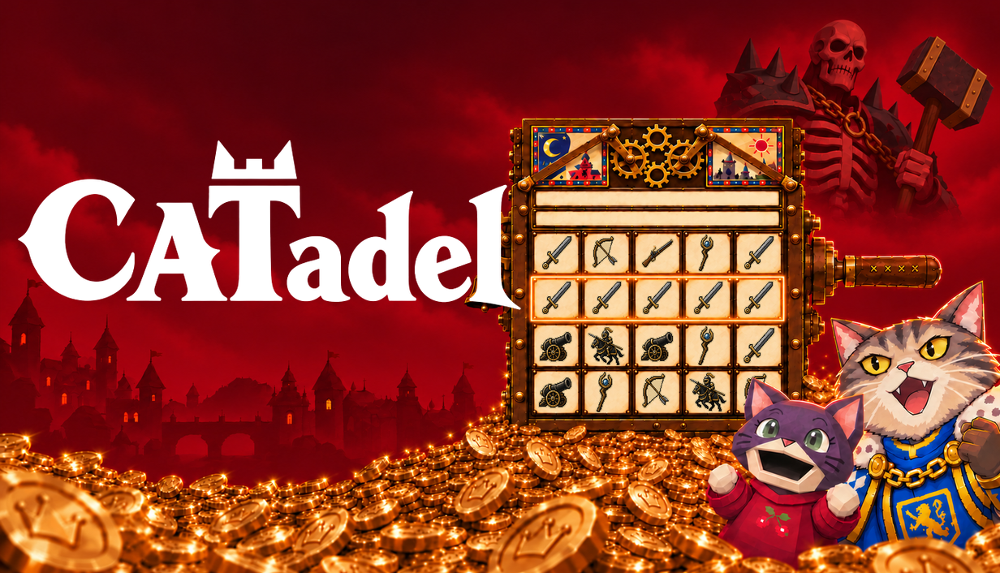
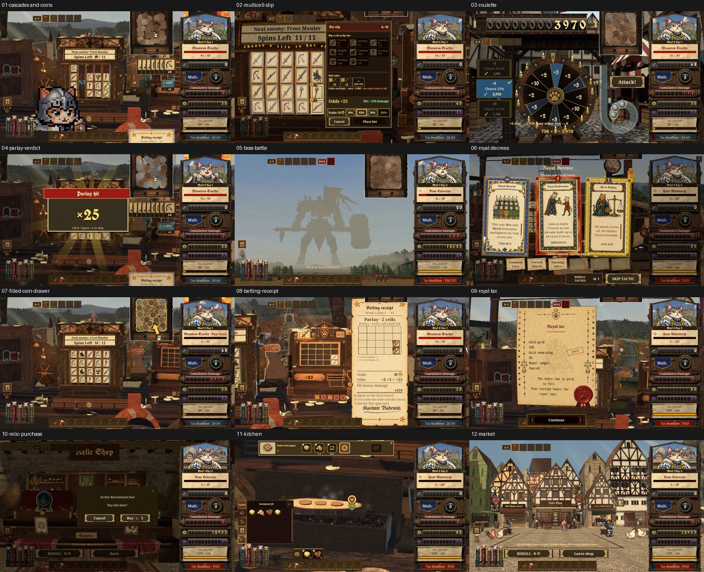

# CATadel Slot Defense Press Kit

**Spin! Collect Gold! Pay your taxes!**

CATadel: Slot Defense is a single-player slot-defense roguelite for Windows PC. Match unit symbols, send a cat army into battle, turn damage into Gold, and decide what to spend before royal taxes arrive.

[Play the free demo](https://store.steampowered.com/app/5273060/) | [Steam and wishlist](https://store.steampowered.com/app/5147270/) | [Download the press kit](https://github.com/dragonstephi/catadel-press-kit/releases/latest)

## Downloads

Video refreshed 22 October 2026: the 20-second gameplay clip now uses Demo v1.6 footage, including miniature cats, live coin collection and carriage combat. Existing screenshots and illustrated guides retain their 20 October v1.5 dates; this release is a video-only refresh.

The latest release contains the complete press kit ZIP: twelve 1920 x 1080 gameplay PNGs, a 20-second gameplay MP4, transparent logos, existing red key art, five-language illustrated guides, and image captions.

Languages: English, Korean, Simplified Chinese, German, and Japanese. The refreshed gameplay screenshots use the English interface. Public full-game release window: Q4 2026.

## Gameplay Screenshots

Demo v1.5, captured 20 October 2026. The original full-resolution PNGs are in the ZIP.

These are full-frame native Player captures, with staged checkpoints and setup to demonstrate features. They are not a continuous unassisted playthrough. The gameplay clip combines normal-speed excerpts from separate moments. Key art and rule diagrams are labeled separately from gameplay.

## Image Use And Contact

The supplied images, logos, and clips may be reproduced for editorial coverage with credit: **Courtesy of DRAGONSTEP STUDIO**.

Press and creator enquiries: **info@dragonstepstudio.com**.

## AI Disclosure

Some pre-made game art, textures, and promotional materials use generative AI tools. No AI content is generated live during play.
